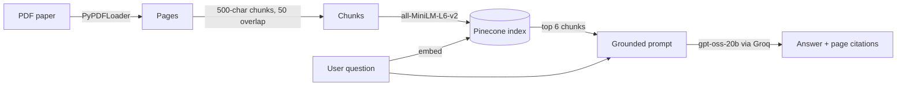

# RAG Document Chatbot for Generative AI in Finance

A deployed retrieval-augmented generation (RAG) chatbot that answers questions about the research paper *A Comprehensive Review of Generative AI in Finance* (FinTech, 2024). Every answer cites the PDF pages it came from. I also built a 30-question eval set to measure how well it works.

**🔗 Live demo:** [sameekshas-rag-chatbot.streamlit.app](https://sameekshas-rag-chatbot.streamlit.app)


---

## 🎯 Highlights

- **End-to-end RAG pipeline:** PDF ingestion and chunking, sentence-transformer embeddings, a Pinecone vector index, and LLM answer generation through Groq
- **Grounded answers with citations:** the app shows the page numbers and source passages behind every answer, and says "I don't know" when the paper doesn't cover the question
- **Measured with an eval set:** answer accuracy improved from **18/30 to 22/30** after tuning retrieval and the prompt. The retriever finds the correct page for **25 of 27** answerable questions, and the bot correctly refuses **3 of 3** questions the paper can't answer.
- **Deployed:** live on Streamlit Community Cloud, with API keys stored in Streamlit Secrets and retry handling for rate limits and dropped connections

---

## 🏗️ How It Works



| Step | Choice | Why |
|---|---|---|
| Chunking | `RecursiveCharacterTextSplitter`, 500 characters, 50 overlap | Small chunks keep each retrieved passage focused on one idea |
| Embeddings | `sentence-transformers/all-MiniLM-L6-v2` (384 dimensions) | Fast, free, and strong for semantic search |
| Vector store | Pinecone serverless index, cosine similarity | Managed and persistent, so the deployed app doesn't re-embed on every load |
| Retrieval | Similarity search, **k = 6** | Raising k from the default improved recall on questions that span sections |
| LLM | `openai/gpt-oss-20b` on Groq, temperature 0.3 | Low latency and low temperature for factual answers |
| Prompt | Answer **only** from the context, or reply "I don't know" | Keeps the model from making things up |

---

## 📊 Evaluation

`eval.py` runs 30 hand-written questions through the same retriever and LLM the app uses. For each question, `eval_results.csv` records the answer, the pages retrieved, whether the correct page was among them, and how long the answer took.

| Question type | Count | What it tests | Right page retrieved |
|---|---|---|---|
| Lookup | 15 | A single fact from one section | 13 / 15 |
| Cross-section | 8 | Combining information from 2+ pages | 8 / 8 |
| Number / table | 4 | Exact figures, cluster counts | 4 / 4 |
| Unanswerable | 3 | Correctly saying "I don't know" | 3 / 3 refused ✅ |

**Answer accuracy:** 18/30 → **22/30** after two changes:
1. Raised retrieval `k` to 6, so questions that span sections get all the passages they need
2. Wrote a stricter grounding prompt that tells the model to read every passage for specific numbers and names, and not to add outside facts

**Latency:** median answer time is about 0.7 seconds. Some answers take around 10 seconds when the Groq free tier rate-limits a request and the retry logic waits.

---

## 👩🏽‍💻 Setup and Installation

**1. Clone the repo and install dependencies**
```bash
git clone https://github.com/sameeksha-mehrotra/rag-chatbot.git
cd rag-chatbot
python -m venv venv && source venv/bin/activate   # Windows: venv\Scripts\activate
pip install -r requirements.txt
```

**2. Add your API keys.** Create a `.env` file in the project root:
```
PINECONE_API_KEY=your_pinecone_key
GROQ_API_KEY=your_groq_key
```
Both have free tiers: [Pinecone](https://www.pinecone.io/) and [Groq](https://console.groq.com/).

**3. Index the document.** Put your PDF at `data/document.pdf`, then run:
```bash
python ingest.py
```
This chunks the PDF, embeds the chunks, and creates and fills a Pinecone index named `rag-chatbot`.

**4. Run the app**
```bash
streamlit run app.py
```

**5. (Optional) Re-run the evaluation**
```bash
python eval.py
```
Results are written to `eval_results.csv`.

> **Using your own document:** replace `data/document.pdf`, re-run `ingest.py`, and update the questions in `eval.py`.

---

## 📁 Project Structure

```
├── app.py              # Streamlit chat UI with page citations
├── ingest.py           # PDF → chunks → embeddings → Pinecone
├── rag_chain.py        # Retriever + LLM + prompt chain (used by eval.py)
├── eval.py             # 30-question evaluation script
├── eval_results.csv    # Latest evaluation results
├── data/               # Source PDF
└── requirements.txt
```

---

## 🚀 Next Steps

- **Score answer correctness automatically** with an LLM grader or exact-match checks, so every eval run measures accuracy and not just retrieval
- **Fix the 2 retrieval misses** on lookup questions about page 1 (title page facts). Try hybrid search (BM25 plus embeddings) or a reranker.
- **Experiment with chunking:** compare chunk sizes and semantic chunking against the current 500-character split
- **Add monitoring** for latency, refusal rate, and token usage in production
- **Support multiple documents**, with per-document filtering in Pinecone metadata

---

## 🙋🏽‍♀️ Author

**Sameeksha Mehrotra** · CS @ UT Austin
[LinkedIn](https://www.linkedin.com/in/sameeksha-mehrotra) · [GitHub](https://github.com/sameeksha-mehrotra)
